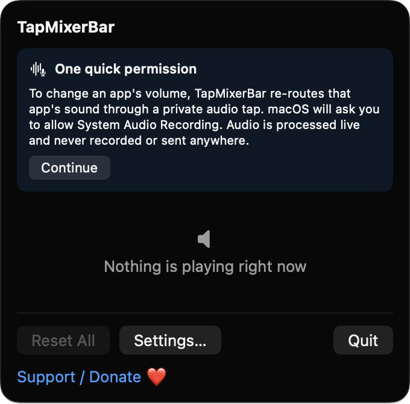
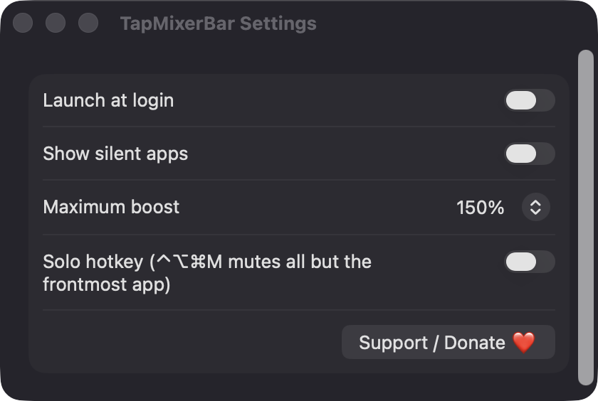

# TapMixerBar

**🌐 Website:** [turhe123.github.io/tap-mixer-bar](https://turhe123.github.io/tap-mixer-bar/)

A menu bar mixer with one volume slider per app playing sound, no virtual audio driver needed.

> 🆓 A free, open-source **Fabar alternative** for macOS 14+. Native Swift, no accounts, no subscriptions, MIT licensed.


## Why

macOS still has no per-app volume control. Paid utilities in the *Audio* category fill that gap. Fabar ($9.99 one-time) was one inspiration for this project. TapMixerBar is a free, open-source, 100% native, backend-free alternative. It is written in Swift and SwiftUI on top of Apple's own Core Audio process taps. It installs no kernel extension or virtual audio device, has no server, and sends nothing anywhere.

## Features

- **One row per app that makes sound**: icon, name, volume slider, percent label and mute button. Helper processes (for example a browser's helper) are grouped under the parent app's name and icon.
- **Volume from 0% up to a 150% boost**. You can cap the boost at 100%, 125% or 150% in Settings. Boosted audio goes through a soft clipper (linear up to 0.9, then a tanh curve) so peaks don't hard-clip.
- **Per-app mute**. The menu bar icon becomes a slashed speaker while any app is muted.
- **Levels are remembered** by bundle identifier and re-applied the next time the app plays. Stored values are clamped to the valid range.
- **No wasted work**: an app at exactly 100% and unmuted gets no tap, so it has no added latency.
- **Reset All** clears every level and mute in one click.
- **Show silent apps** toggle. By default only apps that are playing (or that you've adjusted) are listed.
- **Solo hotkey (optional)**: ⌃⌥⌘M mutes every app except the frontmost one. Press it again to restore the previous state.
- **Launch at login** via `SMAppService`.
- **Follows your output device**: taps are rebuilt when the default output device changes, and the IO proc is restarted when the sample rate changes.
- **Cleans up after itself**: taps and private aggregate devices are torn down when an app quits or its gain returns to 100%. TapMixerBar never taps its own process.
- **Protected audio**: if tapping an app fails after taps have worked for others, the app is shown with a lock icon and a disabled slider.
- **Friendly permission flow**: an explanation card appears before the first tap. If the permission is denied, an inline banner offers "Open Privacy Settings" and "Try Again".
- **Unsupported-OS notice** on macOS 14.0 and 14.1, because process taps need macOS 14.2.
- Runs as a menu bar–only app (no Dock icon).

## Screenshots

<p align="center"></p>

<p align="center"><em>The TapMixerBar menu bar popover on first launch, explaining the one System Audio Recording permission it needs before it can adjust per-app volume.</em></p>

<p align="center"></p>

<p align="center"><em>Settings for launch at login, showing silent apps, the maximum volume boost (up to 150%) and the optional ⌃⌥⌘M solo hotkey.</em></p>

## Install

1. Download `TapMixerBar-macOS.zip` from the [latest release](https://github.com/turhe123/tap-mixer-bar/releases/latest).
2. Unzip it and move `TapMixerBar.app` to `/Applications`.
3. Because the app is open source and not notarized, clear the quarantine attribute:

   ```bash
   xattr -cr /Applications/TapMixerBar.app
   ```

4. Right-click the app and choose **Open** the first time you launch it.

**Requirements:** macOS 14.0 or later to launch. Per-app volume itself needs **macOS 14.2+**. On 14.0 and 14.1 the app shows an "update macOS" notice instead.

## Build from source

You need Xcode with the macOS SDK.

```bash
brew install xcodegen
xcodegen generate
xcodebuild -project TapMixerBar.xcodeproj -scheme TapMixerBar -configuration Release -derivedDataPath ./build build
```

The app is produced at `build/Build/Products/Release/TapMixerBar.app`.

## Permissions

| Permission | When it's requested | Why |
| --- | --- | --- |
| **System Audio Recording** (`NSAudioCaptureUsageDescription`) | The first time a tap is created, after the in-app explanation card | Core Audio process taps need it to re-route an app's sound through the volume control. Audio is processed live and is never recorded or sent anywhere. |
| **Accessibility** | Only if you enable the Solo hotkey in Settings | Lets the app see the ⌃⌥⌘M key press while another app is in front. Everything else works without it. |

TapMixerBar does not request Screen Recording or Microphone access. It does not use the network.

## Built with AI

TapMixerBar was written by [Claude Code](https://claude.com/claude-code) inside an automated pipeline, from a plain-English spec. No code, binaries or assets from any commercial app were used; it is a clean-room reimplementation of a feature set, not a copy.

What that means in practice:

- The full source is in this repo under the MIT license. Read it before you run it.
- No network calls, no analytics, no third-party dependencies. Only Apple frameworks.
- Ad-hoc signed and not notarized, which is why Gatekeeper warns on first launch.
- It has had less human review than a hand-written app. Bug reports and pull requests are welcome.

## Support ❤️

TapMixerBar is free and will stay free. If it's useful to you, you can support its development:

[Support Or (Leo) Davidai ❤️](https://ko-fi.com/leodavidai)

There is also a "Support / Donate ❤️" button in the app's menu and Settings window.

## More free Mac apps

TapMixerBar is one of [60 free, open-source Mac utilities](https://github.com/turhe123/mac-apps) built the same way: native Swift, no accounts, no telemetry. Browse the full gallery at [turhe123.github.io/mac-apps](https://turhe123.github.io/mac-apps/).

## License

MIT © Or Davidai Bachar
